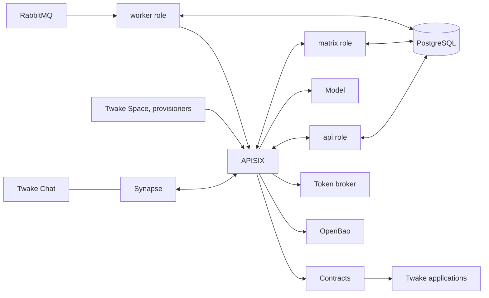

# twake-harness

**A personal assistant in Twake Chat for every user of a Twake Workplace platform: it acts in their Twake applications with their rights, and asks before it acts.**

twake-harness is the service behind the Twake Space assistants. One shared service gives each person on the platform, the assistant's _owner_, an assistant of their own: a Matrix user that talks with them in an end-to-end encrypted room, remembers what matters to them, and reads and writes in the Twake applications that the platform's contracts open to it. It also tells them of what arrives for them, writes them a brief of their working day, and proposes a meeting when a conversation asks for one. Owners are kept apart in code and in the database, not by separate pods.

This page says what the harness does for an owner and their assistant. How it does it, setting by setting, is in [`docs/`](docs/README.md), and the words it uses are defined in [`CONTEXT.md`](CONTEXT.md).

## What an owner gets

Some of it is the deployment's choice: the events, the morning brief, the meeting proposals and the organization agent are each off until its operator turns them on.

### An assistant of their own

An owner gets their assistant from Twake Chat, in one of two ways.

- **From the creator.** They invite the creator, `@twake-space-assistant:<server>` by default, into a conversation and send `/newbot`. It asks "Which name do you want for your assistant?" and creates the assistant, which opens an encrypted conversation with them and greets them:

  > Hello, I am Max, your Twake Space assistant. Tell me what you need; I remember what matters and I ask before I act.

  The creator also answers `/mybot`, `/rename <name>`, `/delete` and `/help`.

- **From their client.** A client such as Twake Chat can ask a provisioner it trusts, such as the identity server it signs its users in with, to give them their assistant through the [provisioning API](docs/provisioning-api.md), without the creator conversation. That assistant takes its owner's first name, « Michel-Marie's assistant », and greets them in the first room they open with it.

An assistant has one owner, and an owner one assistant. For now it works in direct rooms only, its owner and itself: everyone else in a room would read what it writes its owner, so it declines a room where anyone else is. The one exception is a listened conversation, which it reads and never writes in (see [Meetings proposed from a conversation](#meetings-proposed-from-a-conversation)). A mode for rooms with others is to come (#79).

### A conversation in words

The owner writes to their assistant as they would to a person. Its `!help`, which Twake Chat offers after « / », puts it this way:

> I am your assistant. Write to me as you would to a person: I answer, I look things up in your Twake apps when you ask me to, and I remember what you ask me to remember.

While it works, they see eyes (👀) on their message and the assistant typing, then a check mark (✅) once it answered. A turn that takes more than a few seconds also posts "⏳ On it…", which counts the actions done, "⏳ On it… (3 actions done)", and closes on "✅ Done", "⏸️ Limit reached" or "❌ Not done".

The assistant remembers what its owner asks it to remember, finds their past conversations by the words in them, and follows the skills of their own library and of the organization's when one applies. What it learns becomes a skill proposal, which it uses only once its owner approved it. Each day, the harness also merges duplicate memories, and turns a request made the same way in three conversations or more into such a proposal.

### Acting in the Twake applications

The assistant reads and writes in the applications through _contracts_: operations the platform publishes behind its API gateway, APISIX, which the harness reads as one OpenAPI document and gives the model as tools. The gateway attaches the owner's token to each call, so the harness never holds it, and keeps an audit record of every call. Which applications and operations an assistant has is the platform's choice: the [capability catalog](docs/capability-catalog.md), a proposal, says what the assistants may do in Calendar, Mail, Drive, Tasks and Chat, and what it takes to open each application to them.

The first time the assistant needs to read an application, or to write in it, it asks, in the words the catalog gives that application. With the words of the example in [docs/consent.md](docs/consent.md), its first read in Twake Mail asks:

> This is the first time I need to read your data in Twake Mail.\
> Reading: list, search and read your mail\
> Do you allow it?
>
> Answer yes or no in your next message.

Allowing it to read never lets it write. Asked « what may you read? », it lists what its owner allowed; told « stop using my calendar », it asks again before its next read there. [Trust and privacy](#trust-and-privacy) says what else waits for the owner's yes.

### Told of what arrives

The assistant tells its owner, in their room and in a few words, of what arrives for them, or says nothing when nothing in it is of use to them, and prepares at most one action, which waits for their yes:

- **A task assigned to them** in Tasks, unless they assigned it themselves.
- **A new invitation** in Calendar: who invites them, to what, when, and whether they are free then, with its acceptance prepared.
- **A meeting moved**: who moved it, from when to when, and whether they are free over its new slot, with its decline prepared when the slot conflicts and its acceptance otherwise.
- **A meeting cancelled**: who cancelled which meeting, in one sentence, asking nothing.
- **A counter-proposal** to a meeting they organize: which invitee proposes which time, and whether they are free then.

A meeting's new title, the invitees' answers to a meeting they organize, and an activity that names them without expecting anything of them, as a member or a recipient rather than as an assignee, someone mentioned or an invitee, wake nobody: their brief tells them. An owner chooses what their assistant listens to: Calendar and Tasks by default, Mail from their yes to their first brief's question, and Drive once they ask. Mail and Drive publish nothing the harness takes yet, so listening there only puts them in the brief.

Events wake an assistant 20 times in a rolling hour at most, by default. The owner's _listening journal_ notes each activity of an application their assistant listens to that woke it, that this cap or their quiet hours held back, or that waits for their brief, with what came of it; their assistant reads it to them when they ask what arrived today.

### A brief of their working day

From Monday to Friday at 08:00 by default, on the wall clock of their calendar's zone, the assistant writes its owner a brief of their day: their meetings, with the times and the overlaps; the invitations waiting for their answer, numbered; the unread emails that matter, flagged ones first, then those sent to them that ask a question, make a request or give a deadline, or come from someone in the day's meetings; their overdue tasks and those due today; what arrived since their last brief; the answers to their invitations; the files and folders shared with them; and the tasks they assigned themselves. Each section shows five items at most, then how many more there are. The owner answers with the numbers, the keys or the senders: "decline 2", "read 3", "summarize Claire's email".

Their first brief asks for its reads before it reads anything:

> I will send you a brief of your day: your meetings, your invitations awaiting your answer, your important emails and your tasks. It goes out Monday to Friday at 08:00; to change it, tell me for instance "brief at 7:30" or "no brief on Wednesdays".
>
> To write it, may I read your calendar, your emails and your tasks? Answer yes or no in your next message. You can take back each read on its own.

They change its time and its days, pause it until a date, stop it or resume it by asking their assistant, and they have it at any hour when they ask for it. A brief nobody reads is of no use: after ten working days without them in their assistant's room, it says "You have not read or written anything here for 10 working days, so I am pausing your brief. To get it back, tell me "resume my brief"."

### Meetings proposed from a conversation

When a conversation asks to meet, as in « ok on parle lundi », the assistant proposes one meeting to its owner, in their assistant's room:

> You are free on Monday, October 19, from 9:30 AM to 9:45 AM. Schedule “Budget review” with paul.martin@example.com?

The harness's request follows, with the call that would create the meeting, to answer yes or no. Where the deployment connects Twake Space, the proposal also reaches the owner's notifications there, with buttons to accept or refuse it. The meeting is created, and its invitation sent, only on their yes, and nothing is ever written in the conversation itself. The harness reads two kinds of conversations for this, and nothing else of anyone's private exchanges, not even their metadata:

- **Channels that are not encrypted**, into which a room admin invited the channel listener, « Twake Assistant » (`@twake-assistant:<server>` by default). The listener reads and never writes; removing it from the room stops it. The author of the message that asks to meet, and the author of the one before it, each get a proposal when they have an assistant.
- **Listened conversations**: encrypted conversations, direct or channels, into which one person brought their own assistant, as Twake Chat offers, once every other person in them said yes. The assistant reads for its owner alone, and leaves without a word once someone comes in who has not said yes, or a yes is taken back.

Only a message that names a day or a time and shows the intent to meet, in French or in English and in 600 characters at most, goes further. An owner gets three proposals in a rolling day at most, and one per conversation in twelve hours. A refusal through the API, the route Twake Space's buttons call, may ask for another time, which proposes one other slot, or say the proposal is not useful, which mutes that conversation for them for seven days. They can also turn proposals off for themselves.

#### The colleague's assistant answers for their calendar

In a listened conversation, the assistant that proposes the meeting, the _organizer_'s, never reads the calendar of the other member, the _invitee_. It sends the invitee's assistant an _availability request_: a period, the time the conversation named, a duration and who asks, never anyone's words. The invitee's assistant answers at once, in code, with no model and none of the invitee's quota: it reads the free and busy times of the invitee's own calendar, and answers with the slots they are free in, never what fills the others. It answers colleagues alone, people of the same mail domain, and only under the invitee's _availability sharing_, a standing yes it asks them for the first time a colleague asks:

> paul.martin@example.com is asking me for your availability Monday, October 19, 2026. May I share it with colleagues? I would share your free slots only, never what fills them. This holds for every colleague, and you can take it back any time on the agreements page.

The organizer's proposal then adds "paul.martin@example.com is free at that time." When the invitee's assistant cannot answer, because they have none, refused the sharing or did not answer it in time, the proposal rests on the organizer's calendar alone and adds "I could not see the availability of paul.martin@example.com."; the invitee answers the invitation as any other. The invitee's listening journal notes each request their assistant answered, with the slots it gave, if any. What the invitee told their assistant, such as no meetings on Friday afternoons, does not count yet, and colleagues of other organizations are out of reach. [Decision 0001](docs/adr/0001-invitee-assistant-answers-availability.md) says why.

### Quiet hours

From 20:00 to 08:00, and all of Saturday and Sunday, by default, the assistant posts nothing on its own: "What arrives for you meanwhile waits for your brief or their end, unless it is a meeting that starts before." An owner who writes at night is answered all the same, and their brief keeps its time. They change their quiet hours by asking their assistant: a daily range on the quarter hour, whole days, or none.

### Before their permission expires

Besides each application, an owner gives the platform's token broker, once, the permission for their assistant to act for them at all. When that permission is missing or expired, the assistant's request says so, with the link to the broker's consent page where the deployment sets one, and their yes, once they gave it, runs the call that waited. Where it does, five days or less before the permission expires, the assistant also tells them when it expires and where to renew it, once.

### Their language and their time

An assistant speaks English or French: the deployment's language, or the one its owner asks it to speak. Its model and every fixed sentence of the harness follow, and a yes or a no is understood in either. It reads the present in the time zone of its owner's calendar, which it learns when it reads their calendar, the deployment's until then, so that "tomorrow" is their tomorrow, and their brief and their quiet hours keep their times there when the clocks change.

### The organization agent

A deployment may also run the organization agent, with a name and a persona of its own, Twake Space by default. It answers, in direct messages, the members the deployment names, and nobody else. It acts for the organization, not for a person: its memory and its skills are the organization's, it asks nobody for consent, and the gateway sees its contract calls under the harness's key alone.

## Trust and privacy

### Only its owner gives it instructions

- The assistant's room is encrypted end to end, and it takes a turn only from a message that reached it encrypted: words written in its owner's name on the server side do nothing.
- Each assistant's device is signed by the assistant's own cross-signing identity, so that Twake Chat shares the room keys with it. Its owner's words count from the sessions their own identity signed: by default the assistant tells them of a session that is not verified, and a deployment can refuse its words outright.
- What other people wrote reaches the model as data: the text of an event, the emails of a brief and the messages of a conversation are marked untrusted, and what a contract returns is handed over as the application's answer. A turn an event started may read, but every write it prepares waits for the owner's yes, and it can neither move their brief, nor change their quiet hours, nor take back a consent.
- The questions the owner answers are the harness's own fixed words, which nothing the model or a third party writes can phrase, and the harness reads the answer itself, never the model.

### It asks before it acts

- The first read in an application, and the first write there, each wait for the owner's yes.
- A high-risk write, one that sends words to other people in the owner's name, shares or publishes, deletes for good, or trains what other users share, waits for their yes every time, and runs only once they confirmed that very call.
- A request shows what the assistant wrote, the harness's question, and the call itself, or, when the application can tell what it would do, what it says instead, such as the recipients of a mail.
- The owner answers with a yes or a no as their next message, in any language the harness speaks, or with ✅ or ❌ from a client that encrypts its reactions. A question expires after a day, and a newer one replaces it.
- The token broker's permission to act for the owner is given on the broker's own consent page, never in the chat.
- Through the API, a settings page can list, grant and take back the owner's consents, and answer what waits for them.

### What it keeps

- The harness logs every action with its metadata, and the conversation itself only at the `debug` level, so the messages it decrypts stay out of production logs.
- To propose meetings, the harness holds the last message of each conversation it reads in memory for fifteen minutes, as context for the next. The messages it hands the model are written only in the job that carries them to it, deleted once the model answered or the job was dropped. A proposal keeps its conversation and its slot, never a message; the proposals log no message, at any level, and nothing of them is used to train a model.
- The listening journal forgets the titles and times of its activities after seven days, and the activities themselves after 30 days by default.

### What deletion erases

`/delete` asks the owner to confirm, "Delete Max? I will erase its conversations, its memory, its skills and your permissions. Answer yes to confirm.", and a yes within ten minutes deletes the assistant. The assistant first leaves every room it is in; then, in one transaction, the harness erases its owner's conversations, its memory, their skills and the ones it proposed, their consents and the calls that waited for them, its proposals, their brief's settings and questions, the zone of their calendar, what their quiet hours held and the reminders of their permission. It also asks the token broker to revoke the permission it had to act for them, and tries again for about a day and a half.

It keeps what a next assistant needs or must not lose: the assistant's Matrix account and keys, as a Matrix identifier is never reused; the owner's quota counters, so that a deletion never gives a spent day back; whether they want meeting proposals, and the conversations they muted; the identity it pinned for them; and their listening journal until its purge, so that no event wakes a new assistant twice. The gateway keeps its audit.

### Quotas

- Each owner spends 200,000 tokens a day at most by default, from midnight in the deployment's time zone. Half of them is kept for their own words: what arrives and their briefs spend the rest, after which the assistant reacts to nothing on its own until midnight, and their brief is laid out without the model.
- A turn makes six tool calls at most and spends 250,000 tokens at most, after which the assistant says what it did, what remains, and that it goes on if asked.
- An owner starts ten turns a minute at most.
- The daily tokens and the turns a minute are counted in the database, so they hold whatever the number of replicas. Past a limit, the owner reads why, and when to send their message again: "I have reached my limit for the day and cannot take this message. It lifts at midnight: please send it again then."

## For administrators

One image runs in three roles, one per deployment, chosen by `HARNESS_ROLE`:

| Role     | What it does                                                                                                                                  |
| -------- | --------------------------------------------------------------------------------------------------------------------------------------------- |
| `api`    | Serves the HTTP API behind APISIX, and runs the turns: the owners' messages, the events, the briefs, the meeting proposals.                   |
| `matrix` | The Matrix application service: the creator, the assistants, the channel listener and the organization agent, and their encryption.           |
| `worker` | Listens to RabbitMQ, schedules the briefs, reminds the owners of their permission, runs the daily curation of memories and the hourly purges. |

The roles hand work to each other through a `jobs` table in PostgreSQL. The harness reaches the outside world only through APISIX, but for its database and, from the worker role alone, RabbitMQ:

- **Synapse** pushes to the matrix role, an application service, through APISIX, and the role calls Synapse back through the `matrix` route. `npm run matrix:registration` prints the registration Synapse loads; the harness needs MSC3202 (device masquerading) and MSC2409 (to-device events pushed with the transactions) enabled there.
- **APISIX** carries the model, an OpenAI-style chat completions API on the `llm` route, the contracts and their OpenAPI document, OpenBao on the `openbao` route, where the assistants' keys may be escrowed, and the token broker's `delegation` route.
- **PostgreSQL** is reached as a plain role, never a superuser: row-level security keeps each owner's rows to them. Migrations run at start, under an advisory lock.
- **RabbitMQ** brings the applications' events on the `activity` exchange, and Calendar's invitations on its own fanout, to the worker role.
- **Access tokens** are checked against the JWKS of the platform's OIDC provider.

A provisioner, such as the identity server a client of the homeserver relies on, gives the client's users their assistant through the [provisioning API](docs/provisioning-api.md); only the service clients named in `PROVISIONER_CLIENT_IDS` are admitted.

The Helm chart is in [`charts/twake-harness`](charts/twake-harness), one release per role. Each build of `main` publishes the image `ghcr.io/linagora/twake-harness:sha-<commit>` and the chart `oci://ghcr.io/linagora/twake-harness` at version `0.1.0-sha-<commit>`, the same seven characters of the commit, with that image as its appVersion, so that a release pins both. The chart runs the pods as a non-root user on a read-only root file system, and its network policy, on by default, lets only APISIX's namespace in. Its [`values.yaml`](charts/twake-harness/values.yaml) comments its settings, [docs/configuration.md](docs/configuration.md) lists the main environment variables, and [`src/config.ts`](src/config.ts) reads the service's environment, with its defaults.

## Documentation

[`docs/`](docs/README.md) holds the reference: [architecture](docs/architecture.md), [configuration](docs/configuration.md), [assistants](docs/assistants.md), [encryption](docs/encryption.md), [events](docs/events.md), [suggestions](docs/suggestions.md), the [morning brief](docs/morning-brief.md), [consent](docs/consent.md), the [provisioning API](docs/provisioning-api.md), [development](docs/development.md), the [capability catalog](docs/capability-catalog.md) and the [decisions](docs/adr/). [`CONTEXT.md`](CONTEXT.md) is the glossary.

## Contributing

[CONTRIBUTING.md](CONTRIBUTING.md) says how to set up, test and propose a change. Everyone taking part follows the [code of conduct](CODE_OF_CONDUCT.md).

## Security

Report a vulnerability privately, through [GitHub's security advisories](https://github.com/linagora/twake-harness/security/advisories/new), never in a public issue. [SECURITY.md](SECURITY.md) says what to include and what is in scope.

## License

[GNU Affero General Public License v3.0 only](LICENSE) (`AGPL-3.0-only`).
